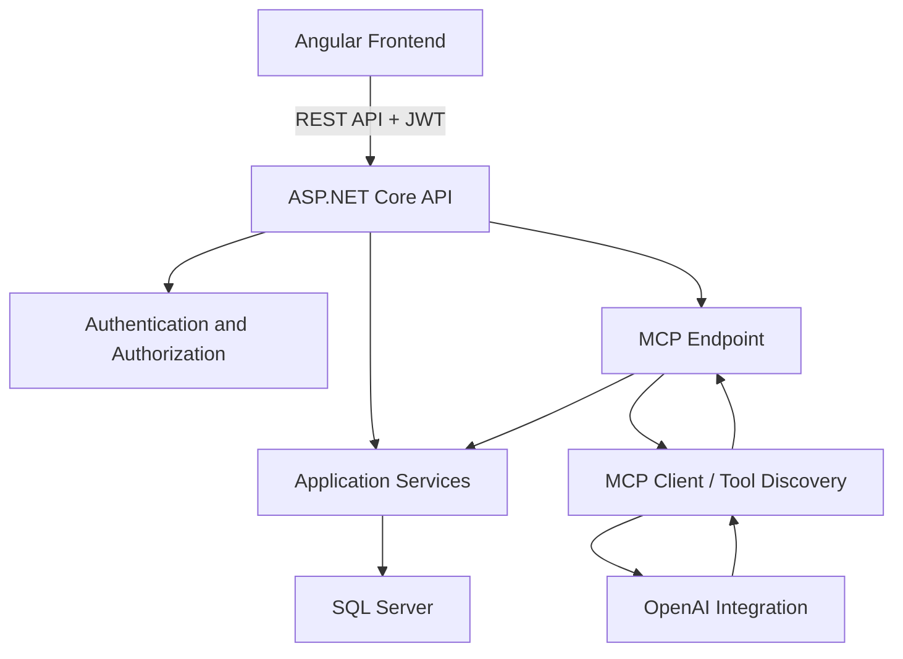

# Workforce360 — Enterprise Workforce Management Platform

An enterprise-oriented workforce management application built with **ASP.NET Core, Angular, SQL Server, and Model Context Protocol (MCP)**, featuring an AI-powered assistant for workforce-related queries.

## Overview

Workforce360 is a full-stack application designed to simplify workforce data management and provide conversational access to organizational information.

The application combines a .NET backend, Angular frontend, relational database, and an AI integration powered by OpenAI and MCP.

## Key Features

- **Authentication:** JWT-based authentication with role-protected API endpoints.
- **Employee Management:** Access employee information through backend services.
- **Department Management:** Retrieve department information and headcount.
- **Leave Management:** Query pending leave requests.
- **AI Assistant:** Ask workforce-related questions using natural language.
- **MCP Integration:** Expose backend capabilities through MCP tools.
- **API Documentation:** Interactive API documentation using Swagger/OpenAPI.
- **Database Integration:** SQL Server with Entity Framework Core.
- **Automated Tests:** xUnit test project.

## Technology Stack

| Layer | Technologies |
|---|---|
| Frontend | Angular, TypeScript |
| Backend | C#, ASP.NET Core Web API |
| Database | Microsoft SQL Server |
| ORM | Entity Framework Core |
| Authentication | JWT Bearer |
| AI | OpenAI API |
| AI Tool Integration | Model Context Protocol (MCP) |
| API Documentation | Swagger / OpenAPI |
| Testing | xUnit |
| Containerization | Docker, Docker Compose |

## Architecture



The AI integration allows the assistant to discover and invoke backend tools through MCP rather than accessing the database directly.

## Project Structure

```text
Workforce360/
├── src/
│   └── Workforce360.Api/
│       ├── Controllers/
│       ├── Services/
│       ├── Data/
│       └── Program.cs
├── frontend/
│   └── workforce360-ui/
│       └── src/
├── tests/
│   └── Workforce360.Tests/
├── docker-compose.yml
└── README.md
```

## Prerequisites

Install the following:

- .NET 10 SDK
- Node.js and npm
- Angular CLI
- Docker Desktop
- Git

## Getting Started

### 1. Clone the repository

```bash
git clone https://github.com/snehalchauhan17/Workforce360.git
cd Workforce360
```

### 2. Start SQL Server

```bash
docker compose up -d sql
```

### 3. Configure application secrets

Navigate to the API project:

```bash
cd src/Workforce360.Api
```

Configure local secrets using .NET User Secrets:

```bash
dotnet user-secrets set "OpenAI:ApiKey" "YOUR_OPENAI_API_KEY"
dotnet user-secrets set "Jwt:SigningKey" "YOUR_SECURE_BASE64_SIGNING_KEY"
dotnet user-secrets set "Demo:Password" "YOUR_DEMO_PASSWORD"
```

Use a securely generated signing key and never commit real credentials.

### 4. Run the backend

```bash
dotnet restore
dotnet run
```

API development URLs:

- HTTP: http://localhost:5080
- HTTPS: https://localhost:7080
- Swagger: http://localhost:5080/swagger

### 5. Run the Angular frontend

Open another terminal:

```bash
cd frontend/workforce360-ui
npm install
npm start
```

If the start script is unavailable:

```bash
npx ng serve
```

Open http://localhost:4200.

### 6. Run tests

From the repository root:

```bash
dotnet test
```

## AI Assistant

The AI assistant supports natural-language workforce queries, such as:

- How many active employees are in each department?
- Show me the department information.
- What leave requests are pending?

The assistant uses OpenAI integration and MCP tools to interact with backend application capabilities.

**Security principle:** The AI model is not an authorization boundary. Access control must be enforced by the backend.

## Security

- Keep API keys and credentials outside source control.
- Use JWT authentication for protected endpoints.
- Enforce authorization in backend services and MCP tools.
- Avoid exposing sensitive employee information unnecessarily.
- Never allow unrestricted database queries generated by an AI model.

## Current Project Scope

This repository is a development starter implementation. Features such as full payroll processing, production identity-provider integration, persistent AI conversation history, and production deployment configuration are not included in the current MVP.

## Future Enhancements

- Employee lifecycle management
- Advanced workforce analytics
- Attendance management
- Leave approval workflows
- Role-based dashboards
- Production-ready CI/CD pipeline
- Expanded automated testing

## Author

**Workforce360 — Enterprise Workforce Management Platform**

Built using ASP.NET Core, Angular, SQL Server, OpenAI, and MCP.
